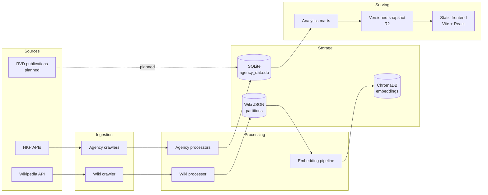

# HK Housing Datahub

An ETL and data-platform project for Hong Kong housing data. It crawls public
estate, building, unit, transaction, and monthly market data from the Hong Kong
Property (HKP) APIs and estate pages from Wikipedia, normalizes it into a
relational SQLite model, and builds text embeddings for retrieval-augmented
applications. The long-term goal is a small, reproducible analytics and serving
layer for a public dashboard.

> **Status:** backend tidy-up complete through Phase 8. The static frontend is
> deployed and verified at <https://hk-housing.monitus.org>; see
> [`docs/deployment.md`](docs/deployment.md) for deployment details.
> See [`docs/workplan-tidy.md`](docs/workplan-tidy.md),
> [`docs/decisions.md`](docs/decisions.md), and
> [`docs/roadmap.md`](docs/roadmap.md). The ML workplan is deferred.

## What it does

- Crawls HKP estate IDs, bilingual estate details, building/unit/transaction
  data, and monthly estate market statistics.
- Crawls Chinese Wikipedia estate pages, extracts section text and tables, and
  stores partition JSON files.
- Loads agency data into a normalized SQLite schema.
- Chunks wiki text and stores Sentence Transformer embeddings in ChromaDB.
- Provides read-only baseline and quality audits, five materialized analytics
  marts, and a versioned serving snapshot published to R2.
- Includes a static React frontend with dataset overview, estate search,
  estate price history, district price trends, an estate map, and recent
  transactions.

## Architecture



More detail: [`docs/architecture.md`](docs/architecture.md).

## Data sources and current scale

| Source | Data | Reference DB |
|---|---|---:|
| HKP | Estates | 9,750 |
| HKP | Buildings | 30,501 |
| HKP | Units | 1,236,321 |
| HKP | Transactions | 1,122,622 |
| HKP | Estate monthly market rows | 546,168 |
| HKP | Unit feature rows | 586,041 |
| Wikipedia (zh) | Estates with wiki data | 824 across 9 partitions |
| ChromaDB | Embedded wiki chunks | 3,780 |

Transaction dates span 1996-01 to 2026-11-08; monthly market data spans
1996-12 to 2026-09-30. The database snapshot is about 518 MB. Full coverage,
reproduction details, and the pre-refresh baseline are in
[`docs/baseline-stats.md`](docs/baseline-stats.md).

Data sources:

- [Hong Kong Property](https://www.hkp.com.hk/zh-hk/list/estate)
- [Wikipedia](https://www.wikipedia.org/)
- [Rating and Valuation Department (RVD)](https://www.rvd.gov.hk/en/publications/property_market_statistics.html)
  — not implemented yet.

API payload notes: [`docs/api_endpoints.md`](docs/api_endpoints.md).

## Quickstart

```bash
python3 -m venv venv
source venv/bin/activate
pip install -r requirements.txt

# For a test/CI-only environment without the optional RAG/cloud stack:
# pip install -r requirements-core.txt -r requirements-dev.txt

# Optional: copy the template and fill credentials only if you will upload.
cp .env.template .env

python src/main.py
```

> **Data prerequisite:** `data/` is not committed. A bare clone cannot build a
> serving snapshot without the reference `data/agency/agency_data.db` and
> `data/wiki/` (or a full crawl). The optional Phase 7 sample database is
> deferred.

**Current entrypoint:** `src/main.py` runs the read-only data-quality checks,
then the RAG embedding pipeline. The agency pipeline, wiki pipeline, and cloud
upload are commented out. The quality step is report-only in `main.py`; use
`scripts/run_quality.py --fail-on critical` to gate. See
[`docs/runbook.md`](docs/runbook.md) for how to run each stage and for the
RAG rerun behavior.

### From clone to snapshot

1. Clone, create the venv, and install `requirements.txt` (or core + dev for
   tests).
2. Place the reference `data/agency/agency_data.db` and `data/wiki/` locally, or
   run the crawler and wiki pipeline.
3. Build marts: `make marts`.
4. Build the local snapshot: `make publish-dry`.
5. Verify it: `python scripts/verify_serving.py --snapshot-dir data/serving/{build_id}`.
6. Optionally publish to R2: `python scripts/publish_dashboard.py`.

### Debug mode

`AgencyOrchestrator(debug_mode=True)` limits the estate list to the first 20
estates for a faster run. It still uses the network and writes to the configured
database, so point it at a copy if you do not want to touch the reference data.
See [`docs/runbook.md`](docs/runbook.md#debug-mode) for the example and caveats.

### Docker

The repository includes a `Dockerfile` and `docker-compose.yml`:

```bash
docker-compose up --build
```

The compose file mounts `./data` and `./logs` into the container. `.dockerignore`
keeps `.env`, `data/`, `logs/`, `venv/`, and local databases out of the image
build context.

### Local data

The `data/` directory is ignored by git. A populated local checkout contains:

```text
data/
  agency/agency_data.db      # SQLite raw model (~518 MB in the reference snapshot)
  agency/estate_ids.txt      # estate ID cache
  wiki/wiki_data_partition_*.json
  chroma_db/                 # ChromaDB persistence
```

If you do not have the data, you can run the crawler (slow, network-dependent)
or use the reference payloads in `docs/api_responses/` for transformation tests.

## Pipeline stages

1. **Agency estates and market data** — fetch estate IDs, then bilingual estate
   info and monthly market statistics in partitions of 100.
2. **Agency buildings, units, and transactions** — fetch transaction data by
   building ID and map units, features, and transactions into the SQLite model.
3. **Wikipedia** — fetch estate pages, section wikitext, and tables; flush each
   partition to JSON.
4. **RAG embeddings** — clean and chunk wiki text, embed with
   `paraphrase-multilingual-MiniLM-L12-v2`, and store in ChromaDB.
5. **Serving snapshot** — build a versioned snapshot from the marts and publish
   it with `scripts/publish_dashboard.py`. The legacy raw uploader is gated
   behind `allow_raw_upload=True`.

The phase plan, guardrails, and acceptance criteria are in
[`docs/workplan-tidy.md`](docs/workplan-tidy.md).

## Data model

The data model has the following groups:

| Group | Tables |
|---|---|
| Location hierarchy | `regions`, `subregions`, `districts` |
| Estates | `estates`, `estate_school_nets`, `estate_facilities`, `estate_mtr_lines`, `estate_monthly_market_info` |
| Buildings | `phases`, `buildings` |
| Units and transactions | `units`, `unit_features`, `transactions` |
| Lookup | `facilities` |
| Run metadata | `pipeline_runs` |
| Analytics marts | `mart_estate_summary`, `mart_district_monthly`, `mart_estate_monthly`, `mart_transaction_recent`, `mart_coverage` |

- ER diagram: [`docs/db.dbml`](docs/db.dbml)
- Column-level dictionary and caveats: [`docs/data-dictionary.md`](docs/data-dictionary.md)

Key caveats: the `transactions` table has no transaction-type column and is
treated as sale transactions; `net_area` is null or non-positive for about
24.0% of units; `bedroom` is missing for about 47%; and `estate_mtr_lines` keeps
only the first MTR line per estate.

## Serving layer

The backend publishes a small versioned snapshot to R2:

```text
dashboard/manifest.json
dashboard/{build_id}/overview.json
dashboard/{build_id}/estate_summary.json.gz
dashboard/{build_id}/district_monthly.json.gz
dashboard/{build_id}/transaction_recent.json.gz
dashboard/{build_id}/estate_monthly.json.gz
dashboard/{build_id}/coverage.json.gz
```

The snapshot is public at <https://hk-housing-datahub.monitus.org>. The manifest
is authoritative; the frontend fetches it first and then the files in
`manifest.files`. The five large data files are gzip-compressed and versioned
data files are immutable/long-cached; both the top-level and versioned manifests
are short-cached (`max-age=60`). `overview.json` remains plain. The manifest
includes build ID, data-through dates, coverage, and mart row counts.
`transaction_recent` exports display columns only; internal join keys stay in
SQLite.

Build/verify/publish:

```bash
make publish-dry
python scripts/verify_serving.py --snapshot-dir data/serving/{build_id}
python scripts/publish_dashboard.py --db data/agency/agency_data.db
```

Full contract: [`docs/serving.md`](docs/serving.md). R2 public access and CORS
are configured for the frontend origin; see
[`docs/deployment.md`](docs/deployment.md).

### Frontend

- **Live:** <https://hk-housing.monitus.org>
- **Snapshot host:** <https://hk-housing-datahub.monitus.org>

```bash
cd frontend
npm ci
cp .env.example .env.local   # set VITE_DASHBOARD_BASE_URL
npm run dev
```

For local development without R2, serve a snapshot and point the app at it:

```bash
# Terminal 1, repo root
python scripts/serve_snapshot.py --snapshot-dir data/serving/{build_id} --port 8787

# Terminal 2
cd frontend
echo 'VITE_DASHBOARD_BASE_URL=http://localhost:8787' > .env.local
npm run dev
```

The frontend covers the overview, estate search and detail (including price
history and recent transactions), district price trends, an estate map, and
recent transactions. See
[`frontend/README.md`](frontend/README.md) and
[`docs/deployment.md`](docs/deployment.md) for Cloudflare Pages/R2 setup.

## Repository layout

```text
src/
  crawlers/       # agency and wiki HTTP clients
  processors/     # response-to-table mapping, wiki parsing, RAG embeddings
  models/         # Pydantic response/output models and SQLAlchemy tables
  orchestrators/  # pipeline entry points
  analytics/      # mart builder and ordered SQL files
  quality/        # read-only data-quality checks and reports
  serving/        # versioned snapshot builder, verifier, and publisher
  config/         # YAML config, Pydantic settings, env loading
  main.py         # current runnable entry point
frontend/         # Vite + React + TypeScript static dashboard
docs/             # workplans, decisions, roadmap, API docs, schema, runbooks
scripts/          # baseline, quality, mart, serving, and snapshot-dev CLIs
data/             # local data, ignored
```

## Configuration

- Runtime configuration: [`src/config/config.yml`](src/config/config.yml)
- Environment template: [`.env.template`](.env.template)
- Settings: `src/config/settings.py`

Cloud credentials are **lazy**: importing the config, constructing the upload
orchestrator, and running local data processing do not require `.env`. The
serving publish path validates credentials only when an upload is attempted and
raises a clear error naming the missing keys. The legacy raw-data uploader is
gated behind `allow_raw_upload=True`.

## Checks

```bash
# Read-only database audit
python3 scripts/baseline_stats.py

# Data quality (read-only; writes data/quality/)
python scripts/run_quality.py --db data/agency/agency_data.db --fail-on critical

# Analytics marts (writes mart_* tables and indexes to the DB)
python scripts/build_marts.py --db data/agency/agency_data.db

# Serving snapshot (local build only; no credentials)
python scripts/publish_dashboard.py --db data/agency/agency_data.db --dry-run
python scripts/verify_serving.py --snapshot-dir data/serving/{build_id}

# Dev tooling: pytest and ruff
pip install -r requirements-dev.txt

# Fixture/DB tests: upserts, run metadata, quality, mapping, marts, serving
pytest -q

# Lint the files touched by the tidy-up so far
ruff check src/main.py src/logger.py src/analytics src/quality src/serving src/processors/agency src/processors/rag src/models/agency/sql_db.py src/models/agency/outputs.py src/orchestrators scripts tests

# Frontend checks
cd frontend
npm ci
npm run typecheck
npm test
npm run build

# Optional shortcuts
make test
make lint
make quality
make marts
make publish-dry
make frontend-check
```

`tests/` contains the Phase 2–6 tests (88 total): upserts, run metadata,
quality checks, response-model parsing, table mapping, duplicate-input dedupe,
synthetic mart builds, serving manifest/publish planning, and offline RAG
idempotency. The boto3-only legacy-upload gate test is skipped in the core-only
CI environment.
The CI workflow
in `.github/workflows/ci-cd.yml` installs `requirements-core.txt` +
`requirements-dev.txt` and runs the same tests and lint. Quality details are in
[`docs/quality.md`](docs/quality.md); mart grains are in
[`docs/data-dictionary.md`](docs/data-dictionary.md#analytics-marts); the
serving contract is in [`docs/serving.md`](docs/serving.md).

## Known limitations

- Scraped third-party data; not an official or authoritative source.
- RVD integration is not implemented.
- The transaction table has no sale/rent type; it is treated as sales.
- Significant nulls: `net_area` (296,938 units null or `<= 0`), `bedroom`
  (583,266 null), missing coordinates (633 estates), missing `first_op_date`
  (887 estates). Estates with a null or non-positive latest price/area are excluded when
  those filters are active.
- Agency SQLite writes are idempotent as of Phase 2: they use SQLite upserts and
  record run metadata in `pipeline_runs`. Rerunning a partition leaves row
  counts unchanged and refreshes non-key columns.
- RAG reruns are idempotent: chunks are written with Chroma `upsert()` and
  every stored ID that is not in the current wiki source is pruned after a
  complete run. Chunk IDs are a SHA-1 of estate name, section title, and chunk
  index, so edited text refreshes in place and removed sections are deleted.
  Pruning is skipped if any wiki file fails to load or if a run produces no
  chunks at all (issue #17).
- The reference DB previously had 160 `buildings.phase_id -> phases.phase_id`
  orphan rows. The mapper now writes only real phase ids, the refresh produced
  0 orphans, and `scripts/repair_orphan_phase_ids.py --apply` repairs older
  databases. `scripts/run_quality.py --fail-on critical` passes; `src/main.py`
  runs the checks in report-only mode by design.
- The legacy raw uploader is disabled by default; when explicitly enabled it
  walks all of `data/`, including the SQLite database and Chroma store. Do not
  point it at a public bucket.
- No live API. The serving layer is a versioned snapshot, not a query service.
- The frontend covers the overview, estate search and detail (price history,
  recent transactions, numeric filters, shareable state), district price
  trends, the estate map, and recent transactions. The map uses OpenStreetMap tiles at
  runtime; no map data is bundled or redistributed.
- R2 public read and CORS are configured for
  `https://hk-housing.monitus.org`. Preview deployments may need additional
  origins.
- The published snapshot and local reference DB both end 2026-11-08 (market
  data 2026-09-30). The project does not run on a schedule yet.
- CI installs core dependencies plus `chromadb` for the offline RAG storage
  tests. The embedding model (sentence-transformers/torch) and cloud upload are
  not exercised in CI.
- The 12- and 24-month mart windows are relative to the latest transaction date
  in the snapshot, not today. `has_wiki` is an exact Chinese-name match.
- `mart_estate_monthly` (~662k rows) is exported as a compact, lazily loaded
  `estate_monthly.json.gz` (~1.3 MB); `mart_transaction_recent` (~87k rows) is
  exported as trimmed JSON.
- The snapshot gzips its five large JSON files (~4.3 MB total). The frontend
  must use the manifest `files` mapping rather than hardcoding names.
- Rent averages in `estate_monthly_market_info` are all zero in the reference
  data, so the rent trend metric renders an explicit empty state.
- The data is not inflation-adjusted and the ML work is deferred.

## Roadmap

1. Phases 0–6 and 8: baseline, repo presentation, config safety, idempotent
   upserts, quality checks, tests/CI, analytics marts, serving snapshot/publish,
   and final handoff. *(implemented; see PRs #24–#30 and the Phase 8 PR)*
2. Phase 7: optional sample database. *(deferred)*
3. Frontend v2: overview, estate search and detail (price history, recent
   transactions, `?estate=` deep links), district price trends, estate map, and
   recent transactions. *(implemented; see [`frontend/README.md`](frontend/README.md))*
4. Add preview-origin CORS if preview deployments are needed. The refreshed
   snapshot is published and the frontend is deployed.
5. Incremental crawls, RVD integration, monitoring, optional Parquet for
   external analytics, and broader accessibility/performance testing. See
   [`docs/roadmap.md`](docs/roadmap.md).
6. ML: hedonic price model, deferred from `docs/workplan-ml.md`.

Architecture trade-offs are recorded in
[`docs/decisions.md`](docs/decisions.md).

## Disclaimer

All data listed in examples is public and owned by Hong Kong Property. This
project is for educational and non-commercial use only. Please refer to the
[HKP Terms of Service](https://www.hkp.com.hk/disclaim.html). The maintainers
make no warranty about accuracy, completeness, or fitness for any purpose.
