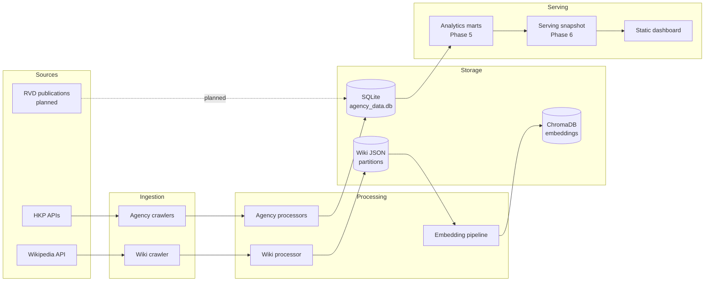

# HK Housing Datahub

An ETL and data-platform project for Hong Kong housing data. It crawls public
estate, building, unit, transaction, and monthly market data from the Hong Kong
Property (HKP) APIs and estate pages from Wikipedia, normalizes it into a
relational SQLite model, and builds text embeddings for retrieval-augmented
applications. The long-term goal is a small, reproducible analytics and serving
layer for a public dashboard.

> **Status:** working prototype being tidied into a portfolio-grade batch data
> platform. See [`docs/workplan-tidy.md`](docs/workplan-tidy.md). The ML workplan
> is deferred.

## What it does

- Crawls HKP estate IDs, bilingual estate details, building/unit/transaction
  data, and monthly estate market statistics.
- Crawls Chinese Wikipedia estate pages, extracts section text and tables, and
  stores partition JSON files.
- Loads agency data into a normalized SQLite schema.
- Chunks wiki text and stores Sentence Transformer embeddings in ChromaDB.
- Provides a read-only baseline audit and a documented path to analytics marts,
  a versioned serving snapshot, and a static dashboard.

## Architecture



More detail: [`docs/architecture.md`](docs/architecture.md).

## Data sources and current scale

| Source | Data | Current snapshot |
|---|---|---:|
| HKP | Estates | 9,748 |
| HKP | Buildings | 29,911 |
| HKP | Units | 1,229,204 |
| HKP | Transactions | 1,071,268 |
| HKP | Estate monthly market rows | 476,986 |
| HKP | Unit feature rows | 563,346 |
| Wikipedia (zh) | Estates with wiki data | 822 across 9 partitions |
| ChromaDB | Embedded wiki chunks | 3,780 |

Transaction dates span 1996-01 to 2025-10-21; monthly market data spans
1996-12 to 2025-08. The database snapshot is about 320 MB. Full coverage and
reproduction details are in [`docs/baseline-stats.md`](docs/baseline-stats.md).

Data sources:

- [Hong Kong Property](https://www.hkp.com.hk/zh-hk/list/estate)
- [Wikipedia](https://www.wikipedia.org/)
- [Rating and Valuation Department (RVD)](https://www.rvd.gov.hk/en/publications/property_market_statistics.html)
  — not implemented yet.

## Quickstart

```bash
python3 -m venv venv
source venv/bin/activate
pip install -r requirements.txt

# Optional: copy the template and fill credentials only if you will upload.
cp .env.template .env

python src/main.py
```

**Current entrypoint:** `src/main.py` currently runs only the RAG embedding
pipeline. The agency pipeline, wiki pipeline, and cloud upload are commented
out. See [`docs/runbook.md`](docs/runbook.md) for how to run each stage and for
the known RAG rerun caveat.

### Local data

The `data/` directory is ignored by git. A populated local checkout contains:

```text
data/
  agency/agency_data.db      # SQLite raw model (~320 MB in the reference snapshot)
  agency/estate_ids.txt      # estate ID cache
  wiki/wiki_data_partition_*.json
  chroma_db/                 # ChromaDB persistence
```

If you do not have the data, you can run the crawler (slow, network-dependent)
or use the reference payloads in `docs/api_responses/` for transformation tests.

## Pipeline stages

1. **Agency estates and market data** — fetch estate IDs, then bilingual estate
   info and monthly market statistics in partitions of 100.
2. **Agency buildings, units, and transactions** — fetch transaction data by
   building ID and map units, features, and transactions into the SQLite model.
3. **Wikipedia** — fetch estate pages, section wikitext, and tables; flush each
   partition to JSON.
4. **RAG embeddings** — clean and chunk wiki text, embed with
   `paraphrase-multilingual-MiniLM-L12-v2`, and store in ChromaDB.
5. **Cloud upload** — legacy uploader for the raw `data/` tree; it will be
   replaced by the versioned serving snapshot in Phase 6.

The phase plan, guardrails, and acceptance criteria are in
[`docs/workplan-tidy.md`](docs/workplan-tidy.md).

## Data model

The relational model has five groups:

| Group | Tables |
|---|---|
| Location hierarchy | `regions`, `subregions`, `districts` |
| Estates | `estates`, `estate_school_nets`, `estate_facilities`, `estate_mtr_lines`, `estate_monthly_market_info` |
| Buildings | `phases`, `buildings` |
| Units and transactions | `units`, `unit_features`, `transactions` |
| Lookup | `facilities` |

- ER diagram: [`docs/db.dbml`](docs/db.dbml)
- Column-level dictionary and caveats: [`docs/data-dictionary.md`](docs/data-dictionary.md)

Key caveats: the `transactions` table has no transaction-type column and is
treated as sale transactions; `net_area` is null or non-positive for about
24.6% of units; `bedroom` is missing for about 48%; and `estate_mtr_lines` keeps
only the first MTR line per estate.

## Repository layout

```text
src/
  crawlers/       # agency and wiki HTTP clients
  processors/     # response-to-table mapping, wiki parsing, RAG embeddings
  models/         # Pydantic response/output models and SQLAlchemy tables
  orchestrators/  # pipeline entry points
  config/         # YAML config, Pydantic settings, env loading
  main.py         # current runnable entry point
docs/             # workplans, API docs, schema, baseline, runbook
scripts/          # read-only utilities (baseline audit)
data/             # local data, ignored
```

## Configuration

- Runtime configuration: [`src/config/config.yml`](src/config/config.yml)
- Environment template: [`.env.template`](.env.template)
- Settings: `src/config/settings.py`

Cloud credentials are **lazy**: importing the config, constructing the upload
orchestrator, and running local data processing do not require `.env`. The
upload path validates credentials only when an upload is attempted and raises a
clear error naming the missing keys. The legacy uploader is not the desired
serving path — see Phase 6.

## Checks

```bash
# Read-only database audit
python3 scripts/baseline_stats.py

# Available after Phase 4
pytest -q
ruff check src tests
```

There is no `tests/` directory or CI yet. Adding fixture-based tests, CI, and
`requirements-dev.txt` is Phase 4.

## Known limitations

- Scraped third-party data; not an official or authoritative source.
- RVD integration is not implemented.
- The transaction table has no sale/rent type; it is treated as sales.
- Significant nulls: `net_area` (302,139 units null or `<= 0`), `bedroom`
  (591,313 null), missing coordinates (632 estates), missing `first_op_date`
  (892 estates).
- SQLite writes are not idempotent yet: `bulk_save_objects()` is used without
  upsert, and deduplication is process-local. Phase 2 fixes this.
- RAG reruns are not idempotent: Chroma `collection.add()` raises on duplicate
  IDs. Tracked in issue #17.
- The legacy cloud uploader walks all of `data/`, including the SQLite database
  and Chroma store. Do not point it at a public bucket.
- No live API. The serving layer will be a versioned snapshot, not a query
  service.
- The reference snapshot ends 2025-10-21; the project does not run on a
  schedule yet.
- The data is not inflation-adjusted and the ML work is deferred.

## Roadmap

1. Phase 0–1: baseline, repo presentation, config safety. *(in progress)*
2. Phase 2: idempotent upserts and run metadata.
3. Phase 3: data-quality checks and reports.
4. Phase 4: fixtures, tests, and CI.
5. Phase 5: analytics marts.
6. Phase 6: versioned serving snapshot and R2 publish.
7. Phase 7–8: optional sample data and final handoff.
8. ML: hedonic price model, deferred from `docs/workplan-ml.md`.

## Disclaimer

All data listed in examples is public and owned by Hong Kong Property. This
project is for educational and non-commercial use only. Please refer to the
[HKP Terms of Service](https://www.hkp.com.hk/disclaim.html). The maintainers
make no warranty about accuracy, completeness, or fitness for any purpose.
