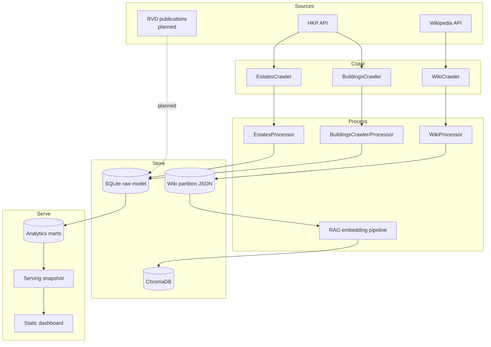

# Architecture

This document describes the current implementation and the planned tidy-up
layers. For the phase plan and guardrails, see
[`workplan-tidy.md`](workplan-tidy.md).

## High-level flow

## Entry point and orchestration

`src/main.py` is a deliberately simple toggle board. Pipeline blocks are
commented in or out rather than driven by CLI flags:

1. `AgencyOrchestrator().run_estates_info_data_pipeline()`
2. `WikiOrchestrator().run_estate_wiki_data_pipeline()`
3. `RAGOrchestrator().run_text_embedding_pipeline()`
4. `CloudUploadOrchestrator().upload_files_from_data_folder()`

At the Phase 0 baseline, only the RAG block is enabled and the cloud upload is
disabled. The agency and wiki blocks are also commented out. See the runbook for
the current state and the RAG rerun caveat.

## Module responsibilities

### Crawlers

| Module | Responsibility |
|---|---|
| `src/crawlers/base.py` | Shared `requests` session wrapper with 3 retries, HTTP error logging, and a 2-second backoff. |
| `src/crawlers/agency/agency_base.py` | Agency session bootstrap; fetches fresh homepage cookies and tests the session. |
| `src/crawlers/agency/estates.py` | Paginated estate IDs, bilingual single-estate info, and estate monthly market info. |
| `src/crawlers/agency/buildings.py` | Building transaction payloads; one request per building ID with a 0.1 s pause. |
| `src/crawlers/wiki/wiki.py` | Wikipedia page lookup with title variations, disambiguation/HK checks, and concurrent section wikitext fetches. |

Notes:

- `AgencyCrawler` performs live network calls in its constructor (homepage
  cookies and a test request). Constructing an `AgencyOrchestrator` therefore
  requires network access.
- Agency pagination uses a page size of 1,000 for estate IDs and partitions
  downstream work in batches of 100 by default.
- The wiki crawler uses the Chinese Wikipedia (`zh`) and a custom user agent.

### Processors

| Module | Responsibility |
|---|---|
| `src/processors/base.py` | Working-directory resolution, data-root creation, and cache clearing. |
| `src/processors/agency/agency_base.py` | SQLite engine/session, table creation, idempotent upserts, run metadata, cache-to-JSON export, and session cleanup. |
| `src/processors/agency/estates.py` | Maps bilingual estate responses to location, estate, school-net, facility, MTR, phase, building, and market rows. Rows are upserted by model primary key; duplicate keys in a batch are absorbed by the SQLite upsert. |
| `src/processors/agency/buildings.py` | Maps building/unit/transaction payloads into `units`, `unit_features`, and `transactions`; optionally keeps only the latest transaction per unit. |
| `src/processors/wiki/wiki.py` | Parses wiki sections and tables, expands rowspan/colspan, and emits CSV table strings alongside section text. |
| `src/processors/rag/embedding.py` | Cleans and chunks wiki text, generates normalized Sentence Transformer embeddings, and writes to ChromaDB. |

### Models

| Module | Responsibility |
|---|---|
| `src/models/agency/responses.py` | Pydantic representations of HKP API responses. |
| `src/models/agency/outputs.py` | Response-to-table mapping models, including date parsing. |
| `src/models/agency/sql_db.py` | SQLAlchemy declarative tables and primary keys. This is the source of truth for the relational schema. |
| `src/models/wiki/outputs.py` | Wiki table/section/page models and CSV rendering. |
| `src/models/rag/documents.py` | Document, metadata, and search-result models. |

### Orchestrators

| Module | Responsibility |
|---|---|
| `src/orchestrators/agency.py` | Runs estate IDs, estate info, market info, and building transactions in partitions. |
| `src/orchestrators/wiki.py` | Reads estate names from SQLite, splits them into partitions, crawls Wikipedia, and flushes JSON. |
| `src/orchestrators/rag.py` | Loads wiki partitions and runs the embedding pipeline. |
| `src/orchestrators/cloud_upload.py` | Legacy raw-data uploader for an S3-compatible bucket (R2 or AWS S3). |
| `src/quality/` | Read-only critical/warning checks and JSON/Markdown reports. |
| `src/analytics/` | Ordered SQL files and a builder for the five `mart_*` tables and dashboard indexes. |
| `src/serving/` | Versioned snapshot builder, manifest verifier, and S3/R2 publisher. |

## Data flow in detail

### Agency path

1. Fetch estate IDs from `https://data.hkp.com.hk/search/v1/estates` with
   pagination; keep IDs starting with `E`.
2. For each partition of estate IDs:
   - fetch single-estate info in `zh-hk` and `en`;
   - map both responses into bilingual rows and single-language rows;
   - fetch monthly market statistics;
   - upsert the partition and clear caches.
3. Build the building ID list from the estate caches.
4. For each partition of building IDs:
   - fetch the building transaction payload;
   - map units, features, and transactions;
   - upsert and clear caches.
5. Close the processor sessions.

### Wiki path

1. Read `estate_name_zh` from the SQLite `estates` table.
2. Split the estate list into `partition_count` partitions (10 by default).
3. For each estate:
   - resolve a Wikipedia page using title variations;
   - skip disambiguation pages and pages that do not mention Hong Kong;
   - fetch section wikitext concurrently;
   - parse sections and tables.
4. Flush each partition to `data/wiki/wiki_data_partition_{n}.json`.
5. Write an aggregated wiki JSON file at the processor's configured path.

### RAG path

1. Glob the wiki partition files.
2. For every estate and section, clean text and chunk it (default 500
   characters, 50 overlap).
3. Generate 384-dimensional normalized embeddings with
   `paraphrase-multilingual-MiniLM-L12-v2` on CPU.
4. Write batches (default 100) to the `hk_housing_wiki` Chroma collection.

### Analytics path

1. The builder reads the raw SQLite tables and the wiki JSON estate names.
2. It creates a connection-local `wiki_estates` temp table for `has_wiki`.
3. It runs ordered SQL files: raw indexes, five mart definitions, then mart
   lookup indexes.
4. It drops/recreates the marts on every run; raw data and columns are
   unchanged, though indexes are added to raw tables.

The resulting marts are documented in
[`data-dictionary.md`](data-dictionary.md#analytics-marts) and are the source for
the serving snapshot.

### Serving path

1. `scripts/publish_dashboard.py --dry-run` builds a snapshot from the marts
   under `data/serving/{build_id}/`.
2. The snapshot contains a `manifest.json`, `overview.json`, and gzipped
   `estate_summary`, `district_monthly`, and `coverage` JSON files.
3. `scripts/verify_serving.py` checks every manifest reference.
4. Without `--dry-run`, versioned files upload first, then the versioned
   manifest, then the short-cache `dashboard/manifest.json` pointer.
5. The legacy raw-data uploader is gated behind `allow_raw_upload=True`.

The manifest and cache contract is in [`serving.md`](serving.md).

## Storage

| Store | Path | Format |
|---|---|---|
| Raw relational model | `data/agency/agency_data.db` | SQLite, WAL mode |
| Analytics marts | `data/agency/agency_data.db` (`mart_*` tables) | SQLite derived tables |
| Estate ID cache | `data/agency/estate_ids.txt` | One ID per line |
| Wiki partitions | `data/wiki/wiki_data_partition_*.json` | JSON keyed by estate name |
| Embeddings | `data/chroma_db/` | ChromaDB persistent store |
| Quality reports | `data/quality/` | JSON + Markdown (Phase 3) |
| Serving snapshot | `data/serving/{build_id}/` | Manifest + gzipped JSON (Phase 6) |

Run metadata lives in the `pipeline_runs` table in the same SQLite database.
`data/` is gitignored. The reference DB is about 320 MB and must be treated as
read-only during development unless a temporary copy is used.

## Dependencies and CI

Runtime dependencies are split by concern:

| File | Contents |
|---|---|
| `requirements-core.txt` | Crawling, parsing, SQLite, config, logging |
| `requirements-rag.txt` | Sentence Transformers and ChromaDB |
| `requirements-cloud.txt` | boto3 |
| `requirements.txt` | Full runtime: core + RAG + cloud |
| `requirements-dev.txt` | pytest and ruff |

`src/orchestrators/__init__.py` uses lazy exports, so importing
`orchestrators.agency` does not pull in the RAG or cloud stacks. CI installs
core + dev only; the optional RAG/cloud paths are not exercised there.

## Configuration and secrets

- YAML: `src/config/config.yml` (URLs, headers, storage paths, cloud service
  selection).
- Environment: `.env`, loaded by `src/config/settings.py`; template is
  `.env.template`.
- Pydantic settings: `Settings` for YAML-backed config and
  `CloudStorageSecrets` for credentials.

`CloudStorageSecrets` fields are optional at import time. The upload path calls
`require_credentials()` and raises a clear error naming missing keys only when
an upload is attempted. This keeps tests and local data processing free of cloud
credentials.

## Current constraints and planned layers

- The raw schema is the current contract; Phase 2 added idempotent upserts and
  the `pipeline_runs` table without renaming existing tables.
- Phase 3 added `src/quality/` checks and JSON/Markdown reports.
- Phase 4 added fixture-based tests, broader coverage, and CI.
- Phase 5 added `src/analytics/`, the five marts, and dashboard indexes.
- Phase 6 added `src/serving/`, the versioned snapshot/publish path, and gated
  the legacy raw uploader.
- Phase 7–8 add optional sample data and the final handoff.
- The ML workplan is deferred.

## Failure modes

- HTTP failures are retried three times and then logged; the caller may skip the
  estate/building.
- Missing wiki pages are skipped after title variations and HK checks.
- A missing `.env` no longer blocks imports; only cloud upload fails.
- SQLite database locking is mitigated by WAL mode, but concurrent writers
  remain unsupported.
