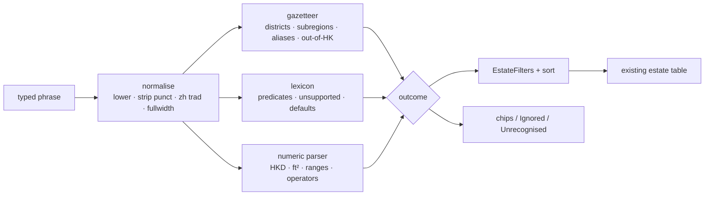

# Epic: Natural-language estate search (deterministic lexicon + distilled reference model)

> **Canonical:** [#145](https://github.com/monitus2022/HK_Housing_Datahub/issues/145).
> This file is the working draft; keep edits in sync or retire it once §15 is decided.

**Status:** Approved as scope on 2026-11-22 by the repo owner.

**Scope note:** `AGENTS.md` pins current scope to `docs/workplan-tidy.md`, and
`docs/workplan-ml.md` is deferred. This epic was approved separately from the
tidy workplan. It does not modify the published snapshot, marts or schema, and
it targets `dev` through the long-lived branch `feat/nl-lexicon-search`.

---

## 1. Problem

The Estates tab exposes ten filter fields (`frontend/src/lib/filters.ts:3`), but
a user has no way to discover them from language. Two consequences:

1. **The filter taxonomy is under-used.** `mtrLine` requires an exact line and
   `schoolNet` an exact net — there is no "any line" or "any net" control, so
   qualitative intent ("near the MTR", "good school net") is unexpressible.
2. **Discovery falls back to substring matching.** `frontend/src/lib/estates.ts:21`
   does a lowercase `includes()` over name and district fields. Measured
   consequence: typing `shenzhen` matches **Kong Sheng Mansion** (Kwai Chung),
   because "shen" is a substring of "Sheng".

There is also no path from a user's own wording ("cheap 2-bed in TKO") to the
filters that would answer it.

## 2. What we are building

> A **browser-side parser that compiles a typed phrase into the dashboard's
> existing filter state**, and shows the user what it applied and what it
> ignored.

It is explicitly **not**:

- text-to-SQL or any SQL generation
- a chatbot, an agent, or multi-turn conversational search
- a recommendation or ranking engine
- a model in the request path (production runs a deterministic lookup table)

## 3. Decisions and rationale

| # | Decision | Rationale |
|---|---|---|
| D1 | **Single-turn only.** One utterance = one query spec | Removes hidden state; identical words always produce identical results |
| D2 | **Output is a filter object**, not SQL | SQL over marts is a separate, later project (see §13) |
| D3 | **Deterministic lexicon is the production artifact** (~50 KB JSON) | Auditable, zero inference, works offline, no hosting, no per-request cost |
| D4 | **Fine-tuned model is a reference artifact**, not a dependency | Demonstrates training + distillation without adding ML risk to the site |
| D5 | **Browser-side only.** No backend | The site is static Pages + R2 today; adding a service for six fields is a bad trade |
| D6 | **Five outcomes:** APPLY, APPLY+IGNORED, APPLY+DEFAULTED, ABSTAIN, REFUSE | Fail closed; never silently drop a constraint |
| D7 | **Gazetteer owns place resolution**, model/lexicon never decides geography | Prevents the "shenzhen → Kong Sheng Mansion" class of error |
| D8 | **Disclosure surfaces are part of the contract:** chips + `Ignored:` + `Unrecognised:` | A wrong parse must look different from a right one |
| D9 | **Lexicon is versioned to the schema, not to the data** | Daily snapshot refreshes must never trigger retraining |
| D10 | **Eval against a human-labelled holdout**, split by sentence family | Template-row splits measure memorisation |

### Outcome contract

| Situation | Outcome | UI |
|---|---|---|
| Fully parsed | APPLY | filters + chips |
| Some constraints unsupported | APPLY+IGNORED | filters + chips + `Ignored:` line |
| Ambiguous, safe default exists | APPLY+DEFAULTED | filters + marked chips |
| No usable slot | ABSTAIN | "I didn't understand that" + examples; previous results kept |
| Out of scope (non-HK, forecast, non-HKD) | REFUSE | reason + an in-scope alternative |

## 4. Measured facts this plan relies on

Verified against `data/agency/agency_data.db` (read-only) and the serving
snapshot on 2026-11-22:

| Fact | Value | Consequence |
|---|---|---|
| Estates / districts | 9,750 / 60 | Closed, small vocabulary |
| Estates with `first_op_date` in last 12m / 24m | 0 / 17 | Estate vocabulary is near-static → no retraining cadence |
| TKO subregion | 5 districts (Hang Hau, Lohas Park, Po Lam, Tiu Keng Leng, TKO Town Centre) | `districtId` is singular; needs a set |
| `estate_summary.json.gz` | 568 KB | Already loaded client-side; no fetch needed for parsing |
| Whole serving snapshot | 5.0 MB | Baseline for artifact-size judgement |
| District labels are compound | e.g. `Happy Valley / Jardine's Lookout`, `Mid-Levels Central  / Admiralty` | 23 of 60 labels are compound; splitting yields 55 extra aliases, 175 in total |
| Cloudflare Pages per-file limit | 25 MiB | Weights must live on R2, never in the bundle |
| R2 egress | $0 | Artifact size is a UX decision, not a cost decision |

## 5. Gaps in the current filter state

`EstateFilters` has ten **single-valued string** fields and no sort. Required
extensions:

| Need | Current | Change |
|---|---|---|
| `TKO` → 5 districts | `districtId: string` | `districtIds: string[]` (or a `subregion` field) + `matchesFilters` branch |
| `near the MTR` (any line) | `mtrLine` requires an exact line | `mtrLinePresent: boolean` |
| `good school net` (any net) | `schoolNet` requires an exact net | `schoolNetPresent: boolean` |
| `cheapest first` | none | `sort` field |
| `for rent` | filters are sale-oriented | explicit sale/rent mode, or a documented refusal |

### Inherited semantics that must be disclosed

- `bedrooms: "2"` reads `estate.latest_bedroom` — i.e. *the most recent
  transaction was a 2-bed*, not *the estate contains 2-bed units*. Estates with
  `latest_bedroom === null` are excluded. This must appear in the chip tooltip.
- Prices are **absolute HKD** (`latest_tx_price = 4280000`), and net-ft prices
  are per ft². `8M` → `"8000000"`; `12k/ft` → `"12000"`.

## 6. Architecture

Precedence: **out-of-scope → gazetteer → lexicon → numeric → unsupported → abstain.**
Longest match first; fuzzy candidate matching with a length-scaled edit distance
and a **margin test** (ask rather than guess when two candidates are close).

## 7. Artifacts

| Artifact | Size | Role | Location |
|---|---|---|---|
| `lexicon-<date>.json` | ~50 KB | **Production** | published with the snapshot |
| `gazetteer.json` | ~30 KB | Generated at build from dimension tables | published with the snapshot |
| `questions.jsonl` + gold | ~200 KB | Eval truth (150 hand-labelled) | git |
| Pruned encoder ONNX int8 | ~34 MB | Optional "try the model" toggle | R2 or HF Hub |
| Checkpoint + model card | ~250 MB | Future reference | HF Hub |
| `report.md` | ~10 KB | Metrics table | git |

## 8. Phases (one branch + PR each, per `AGENTS.md`)

### P1 — Geography model and cascade filters (**shipped**)
- `scripts/build_geo.py` derives region → subregion → district from `mart_estate_summary` into `frontend/src/lib/geo.json`, with a `--check` drift guard
- `EstateFilters` gains `regionId` and `subregionId`; `matchesFilters` ANDs the levels; location counts once
- Region → Subregion → District selects clear their children; a district choice back-fills its parents
- **AC:** artifact deterministic and `--check` clean; cascade filters at all three levels; 156 frontend tests pass; no snapshot change

### P2 — Gazetteer, normaliser, fuzzy matcher
- Generated from dimension tables (districts, subregions, MTR lines, school nets)
- Compound-label splitting (`/`) produces aliases
- Normalisation ladder + edit-distance matching with margin test
- **AC:** `shenzhen` → REFUSE (not an estate match); `tko` → 5 districts; `shaitn` → Sha Tin

### P3 — Lexicon v1 + matcher + disclosure UI  ← **shippable milestone**
- Add `mtrLinePresent`, `schoolNetPresent` and `sort` to the filter state (moved out of P1, where the geography cascade was built instead)
- Hand-curated lexicon: predicates, unsupported, out-of-scope, defaults
- The single-line box: label, placeholder `e.g. 2 bedroom flat in TKO`, Search button, 120-char cap
- Chips + `Ignored:` + `Unrecognised:` rows; four result-area states
- **AC:** the four stress cases behave as specified (§9); zero-result and abstain states render correctly; no backend calls

### P4 — Dataset build
- Template families over real dimension values (~700), frontier/teacher paraphrases (~200), handwritten seeds (~100)
- Split **by sentence family**; the 150 handwritten queries are the held-out test
- **AC:** length histogram (training vs test) recorded; no test item derivable from a training template

### P5 — Teacher labelling, student training, eval report
- Teacher labels the probe set (local 8B, seeded ~8–10k phrases)
- Student: pretrained multilingual encoder, pruned vocabulary, full fine-tune
- Baselines: rules only, rules+lexicon, from-scratch BiLSTM, pretrained encoder
- **AC:** `report.md` contains per-slot F1, whole-query EM, typo slice, artifact sizes; checkpoint + model card published

### P6 — Lexicon v2 from mined data
- Mined entries merged with v1; top 500 by support hand-audited
- **AC:** v2 vs v1 regression table on the held-out set; no metric regresses

### P7 — Docs and release
- `README.md` feature note, `docs/decisions.md` ADR, `docs/deployment.md` artifact hosting
- **AC:** docs match behaviour; deployment notes cover Cache Storage and graceful degradation

## 9. Evaluation

### Metrics

| Metric | Definition |
|---|---|
| Per-slot F1 | district(s), bedrooms, price, area, mtr, school_net, sort |
| Whole-query EM | every slot correct |
| False-filter rate | filters applied that the utterance did not imply **(primary safety metric)** |
| Ignored accuracy | unsupported constraints correctly surfaced |
| Abstain / refuse accuracy | correct on the negative and out-of-scope sets |
| Typo delta | clean F1 minus one-edit-per-word F1 |
| Latency | p50 / p95 in the browser |

### Stress cases (must pass)

| Input | Expected |
|---|---|
| `2 room unit in TKO` | APPLY, 5 districts, bedrooms=2, subregion scope shown |
| `3 room unit in Shenzhen` | REFUSE, HK alternative offered |
| gibberish | ABSTAIN, previous results kept |
| long description with feng shui / sea view | APPLY+IGNORED, supported slots applied, unsupported listed |

## 10. Toolchain and hardware

| Item | Value |
|---|---|
| Training | RTX 3060 8 GB, PyTorch + CUDA, **bf16** (Ampere) — not MLX |
| Student | pretrained multilingual encoder; full fine-tune (no LoRA needed at this size) |
| Teacher | local 8B at Q4 via llama.cpp CUDA (or vLLM + AWQ for batched labelling) |
| Export | ONNX → dynamic int8 quantisation |
| Deps | new `requirements-train.txt` (not referenced by CI) |
| Host machine | M1 16 GB for the browser/eval work |

Measured expectations: student training 2–5 min; teacher labelling ~2.5 h for 8k
phrases (single-stream) or ~40–60 min batched.

## 11. Constraints honoured

- No backend, no new infrastructure (Pages + R2 only)
- Weights never committed; `.gitignore` gains `*.onnx`, `*.safetensors`, `*.pt`, `finetune/out/`
- Tests offline; no network, no credentials, no writes to `data/agency/agency_data.db`
- No full crawl; fixtures only
- Dataset committed (JSONL), weights not — data is the reproducibility anchor

## 12. Risks

| Risk | Mitigation |
|---|---|
| Feature can only express what filters exist | `Ignored:` / `Unrecognised:` disclosure; P1 closes the qualitative gaps |
| Lexicon coverage bounded by the probe set | Mined entries + typo/fuzzy layer + measured typo slice |
| Wiring a model in "to show fine-tuning" | Model stays behind a toggle; lexicon is production (D3/D4) |
| Scope creep into text-to-SQL or chat | D2, single-turn decision, explicit non-goals |
| Silent wrong parse | False-filter rate is the primary metric; chips are removable |
| 120 MB browser download | Prune vocabulary + int8 (~34 MB), or ship lexicon only |

## 13. Non-goals

- Text-to-SQL, SQL generation, or querying marts (a separate project; the
  gazetteer, numeric parser and refusal taxonomy would carry over)
- Multi-turn conversation, session memory, follow-up deltas
- A chat UI, streaming, or an LLM in the request path
- New crawlers, new data sources, or changes to the published snapshot contract
- Unit-level facts (floor, view, orientation, decoration)

## 14. Definition of done (epic)

1. P1–P3 merged and deployed: the box ships with **zero** runtime model and zero
   backend calls.
2. `report.md` published with baselines, per-slot F1, typo slice, and artifact sizes.
3. Lexicon and gazetteer versioned to the snapshot schema and published with it.
4. Docs updated in the same PRs (`README`, `decisions.md`, `deployment.md`).
5. The four stress cases verified in the live build.

## 15. Open questions (need a decision before P1)

1. ~~**Multi-district:** add `districtIds: string[]`, or add a first-class
   `subregion` filter to the UI?~~ **Decided:** a first-class
   region/subregion/district cascade (P1). Subregions such as Tseung Kwan O are
   represented as a subregion filter rather than an array of district IDs.
2. **Sort in scope?** (`cheapest first`, `newest first`) — recommended yes; it
   is what makes `cheap flat` answerable without inventing a budget.
3. **Redirect hint for other tabs?** e.g. "compare Sha Tin and Tai Po" →
   answer with a Trends link instead of filters. ~20 lines; recommended yes.
4. **Ship the model at all?** Options: (a) lexicon only, (b) lexicon + toggle,
   (c) lexicon + hosted endpoint. Recommended (b).
5. **Teacher choice:** local 8B only, or add a ~300-phrase frontier sanity check
   (~$0.50)?
6. **Scope approval:** does this replace or follow `workplan-tidy`?

## 16. Effort

| Phase | Estimate |
|---|---|
| P1 filter state | 0.5 d |
| P2 gazetteer + normaliser | 1 d |
| P3 lexicon v1 + UI (**shippable**) | 1.5 d |
| P4 dataset | 1 d |
| P5 teacher + student + report | 1.5 d (mostly unattended) |
| P6 lexicon v2 + regression | 0.5 d |
| P7 docs + release | 0.5 d |
| **Total** | **~6.5 d ≈ two weekends** |

## References

- `frontend/src/lib/filters.ts` — `EstateFilters`, `matchesFilters`, `activeFilterCount`
- `frontend/src/lib/estates.ts` — current substring search (the baseline being replaced)
- `docs/deployment.md` — Pages + R2 topology, CORS, 25 MiB limit
- `docs/data-catalog.md`, `metadata/catalog.yml` — dataset descriptions and caveats
- `docs/decisions.md` — ADR format for the decisions recorded here
- `docs/baseline-stats.md` — verified counts and coverage
